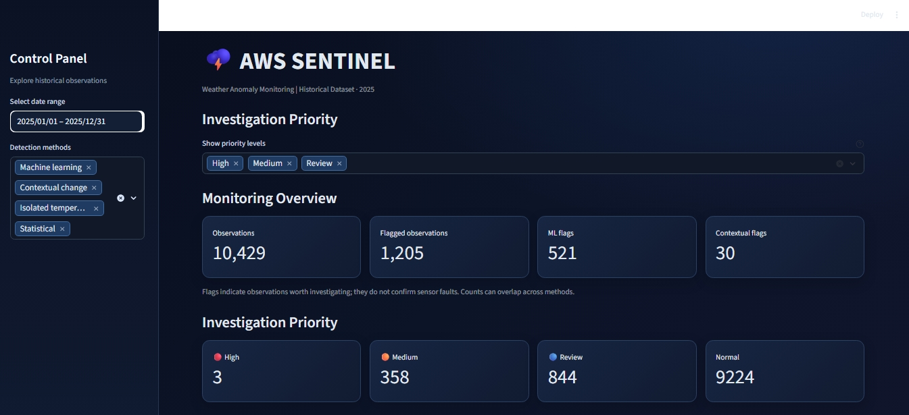
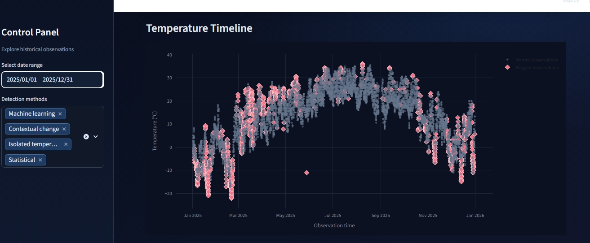

# 🌦️ AWS Sentinel — Weather Anomaly Monitor

An AI-powered weather anomaly detection dashboard built with **Python, Streamlit, and Machine Learning**. AWS Sentinel helps explore weather data, identify unusual patterns, and visualize detected anomalies through an interactive dashboard.

## ✨ Features

- 📊 **Interactive Dashboard** — Explore weather anomaly results through visualizations.
- 🤖 **Machine Learning** — Uses anomaly detection techniques to identify unusual observations.
- 📈 **Statistical Analysis** — Supports analysis of weather patterns and deviations.
- 🕒 **Time-Aware Detection** — Includes detection logic designed to consider time-related patterns.
- 🔎 **Unified Anomaly Report** — Brings detection results together for dashboard analysis.

## 🛠️ Tech Stack

- **Language:** Python
- **Dashboard:** Streamlit
- **Data Analysis:** Pandas
- **Visualization:** Plotly
- **Machine Learning:** Scikit-learn
- **Model Utilities:** Joblib

## 📁 Project Structure

```text
aws-sentinel/
├── app.py
├── requirements.txt
├── .gitignore
├── data/                 # Local datasets (not tracked by Git)
├── models/               # Local trained models (not tracked by Git)
├── notebooks/            # Exploratory analysis
├── reports/
│   └── unified_anomaly_report.csv
└── src/
    ├── change_detection.py
    ├── clean_data.py
    ├── contextual_detection.py
    ├── detect_anomalies.py
    ├── inspect_data.py
    ├── ml_anomaly_detection.py
    ├── statistical_detection.py
    ├── time_aware_detection.py
    ├── unified_anomaly_report.py
    └── visualize_anomalies.py
```

## 🚀 Getting Started

### 1. Clone the repository

```bash
git clone https://github.com/Angelina-Renny/aws-sentinel.git
cd aws-sentinel
```

### 2. Create a virtual environment

```bash
python -m venv .venv
```

Activate it on Windows PowerShell:

```powershell
.\.venv\Scripts\Activate.ps1
```

### 3. Install dependencies

```bash
pip install -r requirements.txt
```

### 4. Run the dashboard

```bash
python -m streamlit run app.py
```

## 🚀 Live Demo

👉 [Launch AWS Sentinel Dashboard](https://aws-sentinel-dashboard.streamlit.app/)

The dashboard should open in your browser. The app expects its unified anomaly report at `reports/unified_anomaly_report.csv`.

## 🖥️ Dashboard Preview

### 1. Main Dashboard


### 2. Detection Methods


### 3. Flagged Observations


### 4. Monthly Anomaly Analysis


### 5. Temperature Timeline


### 6. Anomaly Investigation


## 🎯 Project Goal

The goal of AWS Sentinel is to make weather anomaly analysis easier to explore by combining data processing, anomaly detection, and interactive visualization in one place.

## 🔮 Future Improvements

- Deploy the dashboard online.
- Add more interactive filters and visual insights.
- Improve anomaly explanations and reporting.
- Explore additional weather datasets and detection methods.

## 👩‍💻 Author

**Angelina Renny**

GitHub: [@Angelina-Renny](https://github.com/Angelina-Renny)

---

*Built as a Python and machine learning project for exploring weather anomaly detection.*
